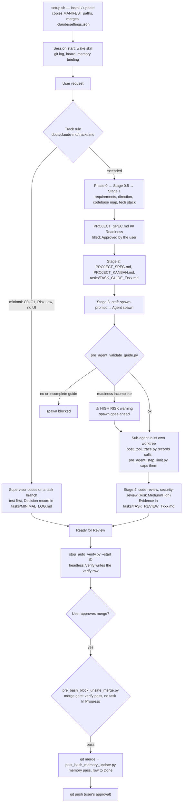

# Main flow — Easy Kit

How a request moves through the kit, from install to a pushed merge. Each box names the file that
does the work. Detail: `AGENTS.md`, `docs/claude-md/tracks.md`, `docs/claude-md/pipeline-stages.md`.

