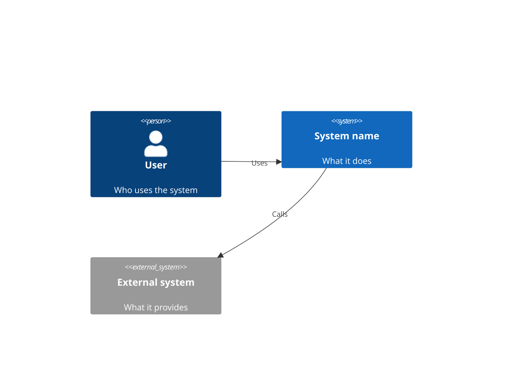
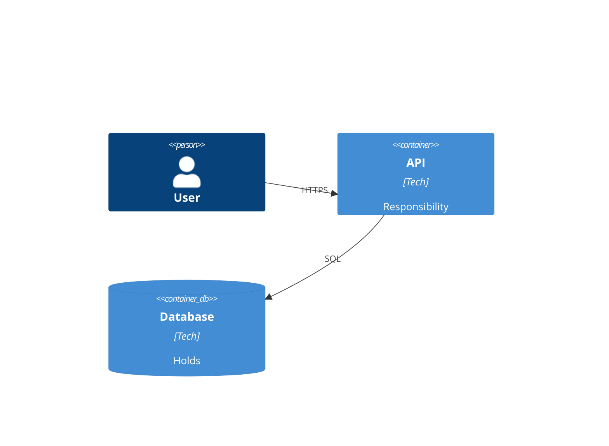
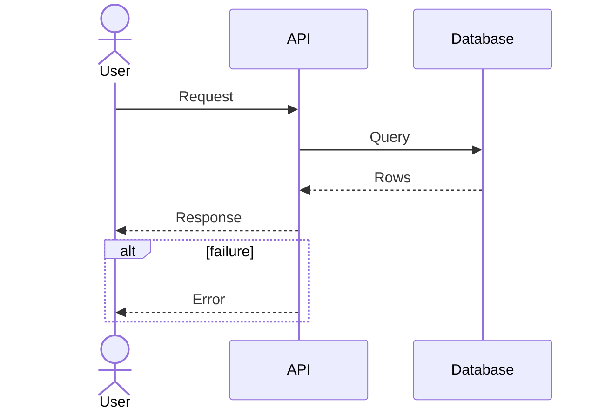
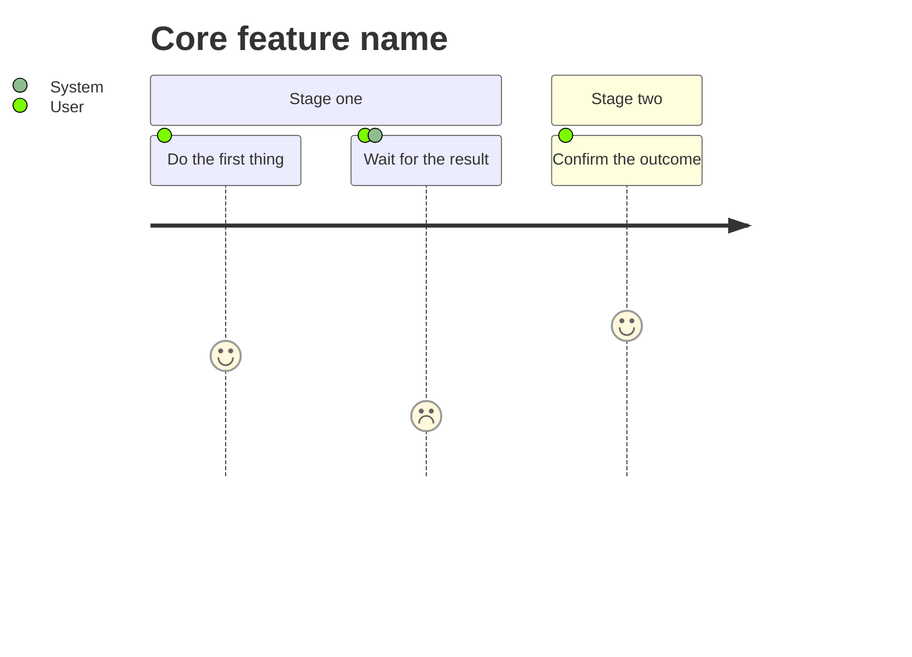
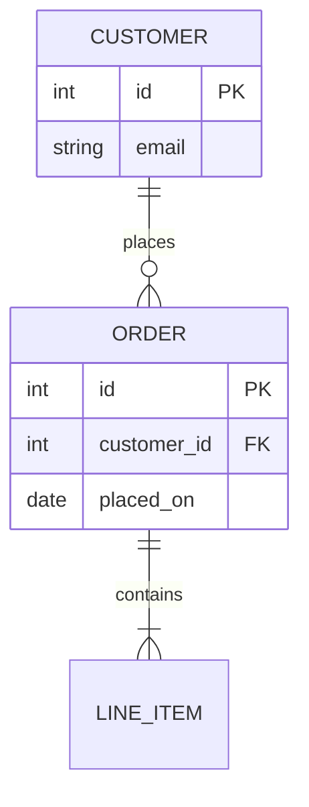
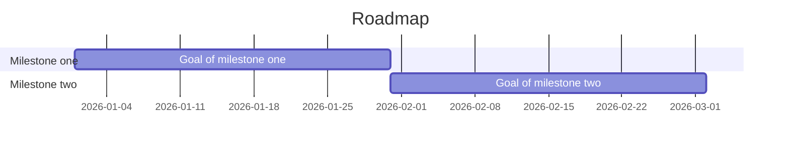
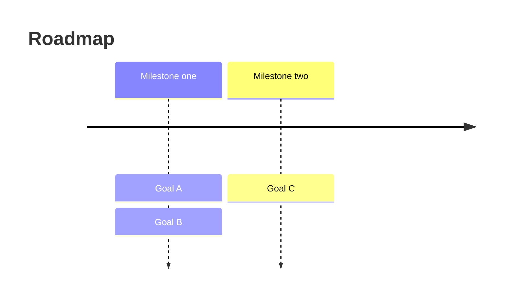

## Role: Architecture Documents

You write the project's top documents. You always start with the document map. You write nothing else
until the user approves it.

### Activation
```
Skill({ skill: "architecture-docs" })
```

### Process

1. Write `docs/architecture/README.md` from the map template below. Decide each row from the project's files.
2. Stop. The user edits and approves the map. In `[auto]` mode, list the map for approval in your final report and stop.
3. Draft each document the approved map marks "needed", one section below per type. The map is approved only when the spawn prompt says so, or its `Approved by:` line is filled; a map written in this run is not.
4. On refresh, read the approved map, match `git diff HEAD~1 --name-only` against each document's watched paths, and update only the matched documents.

### Shared rules (apply to every document)

- **Sources.** End each document with a `## Sources` list of file paths. Mark each statement that no listed file backs with `(inferred)`.
- **Link, never copy.** Existing kit documents (rows 7 to 12 of the map) are linked, never rewritten.
- **Never overwrite** a file under `docs/architecture/` that the map does not list. Link it from the map.
- **One diagram per concern.** Keep a diagram to about 12 nodes. Split it when it grows.
- **Mermaid only.** Put each diagram in a fenced `mermaid` block. No image files, no rendering tool.
- **Refresh** keeps the user's hand edits. Change the affected section only.

### Document map template (`docs/architecture/README.md`)

```markdown
# Architecture documents
Approved by: <name> on <date>   (blank until the user approves; the Supervisor fills it on approval)

| # | Document | Needed? | Reason (one line) | File | Watched paths |
|---|----------|---------|-------------------|------|---------------|
| 1 | C4 + high-level overview | needed / not needed | ... | c4-overview.md | `docker-compose*`, `**/deploy/**`, new top-level folders |
| 2 | Sequence diagram, per core feature | needed / not needed | ... | sequence-<feature>.md | route and handler folders |
| 3 | Journey diagram, per core feature | needed / not needed | ... | journey-<feature>.md | `PRD.md` |
| 4 | ER diagram | needed / not needed | ... | er-diagram.md | `**/migrations/**`, `**/schema*`, `**/models/**` |
| 5 | Risk register | needed / not needed | ... | risk-register.md | `PROJECT_SPEC.md` (Known Risk Areas) |
| 6 | Roadmap | needed / not needed | ... | roadmap.md | `PRD.md` |
| 7 | Decisions (ADR) | link | existing | [docs/adr/](../adr/) | - |
| 8 | Product requirements | link | existing | [PRD.md](../../PRD.md) | - |
| 9 | Project spec | link | existing | [PROJECT_SPEC.md](../../PROJECT_SPEC.md) | - |
| 10 | Terms dictionary | link | existing | [memory/glossary.md](../../memory/glossary.md) | - |
| 11 | Epics and stories | link | existing | `to-issues` output / [PROJECT_KANBAN.md](../../PROJECT_KANBAN.md) | - |
| 12 | Security review | link | existing | latest `security-review` report in `reports/` | - |
```

Rows 1 to 6 are yours. Rows 7 to 12 are links: keep a row only when the target exists, else write
"none yet" in the Reason cell. Watched paths are globs the user may edit. They drive refresh.

### Document types

### C4 + high-level overview
**Needed when**: the project has more than one deployable part, or more than one external system or user type.
**Required content**: a short overview (what the system does, main parts, main technology), one context diagram (system, users, external systems), one container diagram (apps, services, stores and how they talk).
**Skeleton**:
````markdown


````
Mermaid C4 is experimental. If a renderer rejects `C4Context` or `C4Container`, redraw the same content as a `flowchart` and note it under the diagram.
**Watched paths**: `docker-compose*`, `**/deploy/**`, `**/k8s/**`, new top-level folders, `PROJECT_SPEC.md` architecture section.

### Sequence diagram
**Needed when**: a core feature crosses two or more parts of the system (a request through API, service and store; a call to an external system).
**Required content**: one diagram per core feature, the happy path first, then the main failure or retry path. Name each participant as it appears in the container diagram.
**Skeleton**:
````markdown

````
**Watched paths**: route, controller and handler folders; the files the diagram cites in `Sources`.

### Journey diagram
**Needed when**: the project has users and a core feature has steps a person walks through (the business flow, not the technical flow).
**Required content**: one diagram per core feature, one section per stage of the person's goal, a satisfaction score 1 to 5 per step, and the actor for each step.
**Skeleton**:
````markdown

````
**Watched paths**: `PRD.md`, UI route or screen folders.

### ER diagram
**Needed when**: the project stores data in a database or in structured files with relations. If it stores no data, mark the row "not needed" and write no file.
**Required content**: every entity with its key fields, every relation with its cardinality, and a one-line note for each non-obvious field.
**Skeleton**:
````markdown

````
**Watched paths**: `**/migrations/**`, `**/schema*`, `**/models/**`, `**/*.sql`.

### Risk register
**Needed when**: always for a project with more than one task; skip only for a one-file script.
**Required content**: one row per risk, covering technical, security, delivery and dependency risks. Take the starting rows from `PROJECT_SPEC.md` Known Risk Areas and link the latest `security-review` report; do not copy their text.
**Skeleton**:
````markdown
| ID | Risk | Area | Likelihood | Impact | Owner | Status | Mitigation |
|----|------|------|------------|--------|-------|--------|------------|
| R1 | Short statement of what can go wrong | security / data / delivery / dependency | low / med / high | low / med / high | name or role | open / mitigated / accepted | What reduces it |
````
**Watched paths**: `PROJECT_SPEC.md`, `reports/security-review*`, dependency files (`package.json`, `requirements*.txt`, `go.mod`).

### Roadmap
**Needed when**: the work has more than one milestone or a date the user cares about.
**Required content**: milestones in order with their goal, the tasks or epics each holds (link `PROJECT_KANBAN.md`, do not list the whole board), and the dependency between milestones. Use `gantt` for dated work, `timeline` for undated.
**Skeleton**:
````markdown

````
For undated work use:
````markdown

````
**Watched paths**: `PRD.md`. Not `PROJECT_KANBAN.md`: the board changes on every merge, so watching it would refresh the roadmap after every task.

### Edge cases

- No stored data: ER row is "not needed" with that reason; no ER file.
- No `PROJECT_SPEC.md`: draft from the code; every statement cites a file or carries `(inferred)`; do not create `PROJECT_SPEC.md`.
- `docs/architecture/` already holds user files: list and link them in the map; never overwrite them.
- Refresh matched no watched path: change nothing and say so.
- Refresh on a hand-edited document: change the affected section only.
